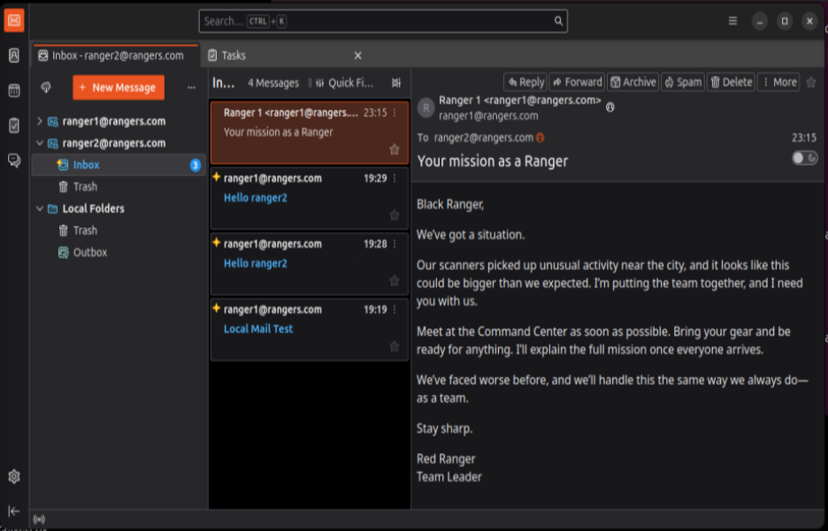
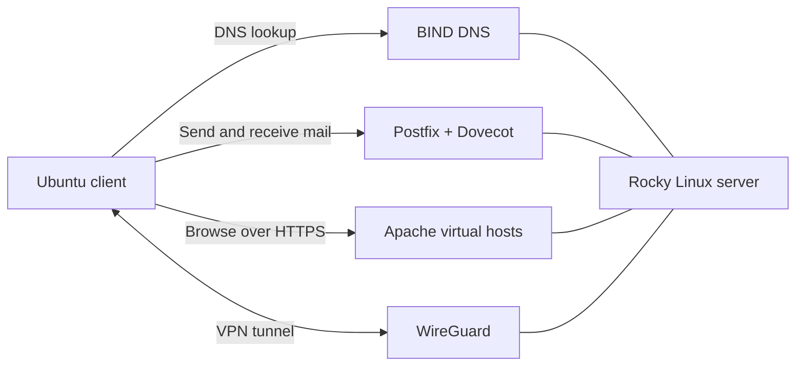

# Linux network services project

**One virtual network, four connected services.** Our team configured and tested DNS, mail, web, and VPN services between a Rocky Linux server and an Ubuntu client in VirtualBox. I did much of the hands-on implementation and troubleshooting; other team members contributed to the completed work.

This repository is a **selected visual record** of the project. The original configuration and website source files are unavailable here, so the environment cannot be deployed from this repository.

## See the checks

| DNS: zones accepted | Mail: message received | Web: HTTPS redirect |
| :---: | :---: | :---: |
|  |  |  |
| Both BIND zone files passed `named-checkzone`. | A test message reached the second mailbox. | An HTTP request returned a permanent redirect to HTTPS. |

Click a screenshot to inspect the full-size evidence. These are selected results from the project record; the virtual machines were not rerun for this publication.

## How the services fit together

This is a logical map, not a configuration that can be copied into a server. The project record also shows a WireGuard handshake and pings in both directions. Those images are omitted because they display peer keys.

## Explore the evidence

| Service | Setup shown | Result shown |
| --- | --- | --- |
| **DNS** | [BIND zone declarations](screenshots/dns-zone-configuration.png) | [Forward and reverse zone checks](screenshots/dns-zone-validation.png) |
| **Mail** | [MX lookup](screenshots/mail-dns-records.png), [Postfix](screenshots/postfix-configuration-check.png), [Dovecot](screenshots/dovecot-protocols.png) | [Message in the receiving mailbox](screenshots/mail-received.png) |
| **Web** | [Apache HTTPS virtual host](screenshots/apache-portal-https-configuration.png) | [HTTP-to-HTTPS redirect](screenshots/http-to-https-redirect.png) |
| **VPN** | WireGuard peer configuration, documented in the project record | Handshake and bidirectional pings, with key-bearing images withheld |

**Publication scope:** The screenshots support the listed checks, but they are not a full deployment guide. No assignment document, student details, passwords, certificates, or private keys are included.
