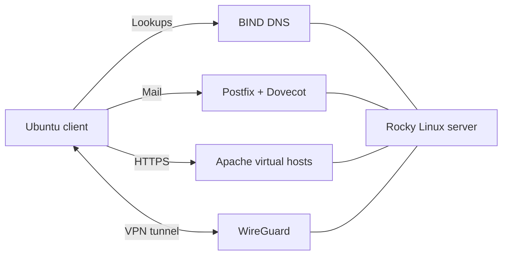
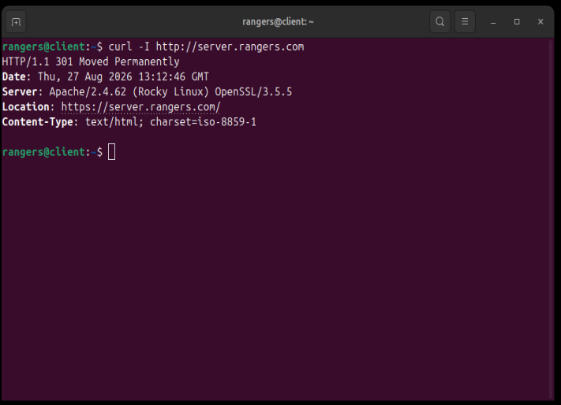

# Linux network services project

This repository presents a **team project** built in a virtual Linux network. I carried out much of the hands-on implementation and troubleshooting, with other team members contributing to the completed work. The environment used a Rocky Linux server and an Ubuntu client in VirtualBox.

We set up and tested four connected services:

- **DNS:** BIND forward and reverse zones, checked with `named-checkzone` and client lookups.
- **Mail:** Postfix and Dovecot, with DNS mail records and a two-way Thunderbird mail test.
- **Web:** Apache virtual hosts with HTTPS and an HTTP-to-HTTPS redirect.
- **VPN:** WireGuard between the server and client. The project record shows a handshake and successful pings in both directions; those images are omitted here because they display peer keys.

*Logical view of the virtual network. The diagram is a guide to the services, not a deployable configuration.*

## Results at a glance

The zone checks completed successfully, a test message reached the second lab mailbox, and the web server returned a permanent redirect to HTTPS. These are examples from the project record; the full system was not rerun for this publication.

*BIND accepted both zone files.*

*The web server redirected an HTTP request to the HTTPS address.*

## Selected screenshots

| Area | Screenshot | What it shows |
| --- | --- | --- |
| DNS setup | [Zone configuration](screenshots/dns-zone-configuration.png) | BIND zone declarations. |
| DNS test | [Zone validation](screenshots/dns-zone-validation.png) | Forward and reverse zone checks completed successfully. |
| Mail DNS | [Mail records](screenshots/mail-dns-records.png) | Client lookup of the mail host and MX record. |
| Mail setup | [Postfix settings](screenshots/postfix-configuration-check.png) and [Dovecot settings](screenshots/dovecot-protocols.png) | Selected server configuration views. |
| Mail test | [Received test message](screenshots/mail-received.png) | A message reached the second lab mailbox. |
| Web setup | [HTTPS virtual host](screenshots/apache-portal-https-configuration.png) | An Apache TLS virtual host configuration view. |
| Web test | [Redirect check](screenshots/http-to-https-redirect.png) | An HTTP request received a permanent redirect to HTTPS. |

These screenshots document the work. The original server configuration and website source files were not available in the local project folder when this repository was prepared, so this is **not a deployable copy**. No submission document, student details, passwords, certificates, or private keys are included. The virtual machines were not rerun for this publication.

