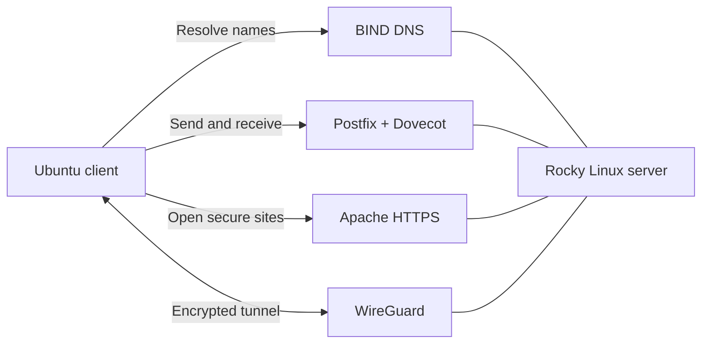
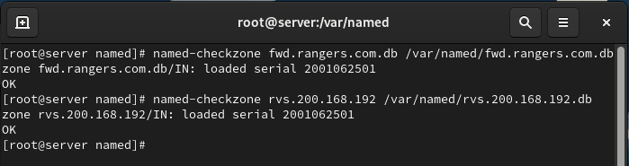

# Linux network services project

Our team built a small virtual network to see whether a Linux client could use several services hosted together on a Linux server: **name resolution, email, secure websites, and a VPN**. I carried out much of the hands-on implementation and troubleshooting; other team members contributed to the integrated project. The server ran Rocky Linux, the client ran Ubuntu, and both ran in VirtualBox.

This repository is a **visual case study**, not a deployment package. It contains selected screenshots of configuration and results. The original configuration files, website source, and virtual machines are not available here, so the environment cannot be recreated from this repository alone.

## What the network had to demonstrate

The services were connected rather than tested as isolated installations. DNS needed to resolve the server and mail host; mail needed working DNS records, Postfix delivery, Dovecot mailbox access, and a client that could send and receive; the web server needed HTTPS and a redirect from HTTP; the VPN needed a working peer handshake and traffic across the tunnel.

*Logical service map. It explains the relationships; it is not a deployable configuration or a record of a fresh test.*

## Three checks you can inspect

| DNS: zones accepted | Mail: message received | Web: HTTPS redirect |
| :---: | :---: | :---: |
|  |  |  |
| Both zone files passed `named-checkzone`. | A message reached the second test mailbox. | An HTTP request returned a permanent redirect to HTTPS. |

Click any image for the full-size view. These screenshots document selected outcomes from the original project; the virtual machines were not rerun to prepare this publication.

## Implementation and verification

### 1. Resolve names with BIND

The server had forward and reverse zones. We checked their syntax with `named-checkzone` and used lookups from the client as part of the wider network test. The project record describes removing local host-file entries before lookup testing, so a successful response would come from DNS rather than a shortcut in `/etc/hosts`. The public evidence includes the [zone declarations](screenshots/dns-zone-configuration.png) and [validation output](screenshots/dns-zone-validation.png).

### 2. Deliver and read mail

DNS mail records pointed clients to the mail host. Postfix handled SMTP transfer and Dovecot handled mailbox access; Thunderbird was the client used for the exchange. The published screenshots show an [MX lookup](screenshots/mail-dns-records.png), selected [Postfix](screenshots/postfix-configuration-check.png) and [Dovecot](screenshots/dovecot-protocols.png) settings, and a [received test message](screenshots/mail-received.png). Together they make the path from name lookup to mailbox result easier to follow, though they are not a complete server configuration.

### 3. Serve a site over HTTPS

Apache served virtual hosts with TLS. The [virtual-host view](screenshots/apache-portal-https-configuration.png) shows part of the secure-site setup, while the [redirect check](screenshots/http-to-https-redirect.png) shows an HTTP request receiving a permanent redirect to HTTPS. The screenshot demonstrates that response for the tested address; it does not establish how a separately deployed site would behave.

### 4. Connect the VPN peers

WireGuard was added between the server and client. The original project record documents a handshake and successful pings in both directions after the peer configuration was corrected. VPN screenshots are omitted from this public copy because they expose key material. There is no safe configuration file here to run as a sample.

## Troubleshooting that shaped the result

Several failures were useful in separating network reachability from a working service:

| Symptom | What the team checked | Recorded resolution |
| --- | --- | --- |
| Thunderbird could reach the mail host but did not trust its certificate. | A TLS connection test showed the server was reachable while certificate validation failed. | A locally signed mail certificate and the public CA certificate were used for client trust; the private CA key stayed on the server. |
| Mailbox login failed even though the user existed. | A direct Dovecot authentication test succeeded. | The client trust and secure-connection path was corrected instead of recreating the account. |
| WireGuard sent packets but had no handshake or successful ping. | The active peer public keys were compared on both machines. | The peer keys were corrected and the services restarted; the project record then showed a handshake and bidirectional traffic. |

These troubleshooting details come from the original project record; the public repository contains only the selected screenshots above. They are included to explain the engineering work, not as independently rerun results.

## Publication scope

The screenshots support the visible DNS, mail, and web checks. They do not supply every command, configuration file, certificate, or test needed to reproduce the network. No original reports, student details, passwords, certificates, or private keys are published here.
